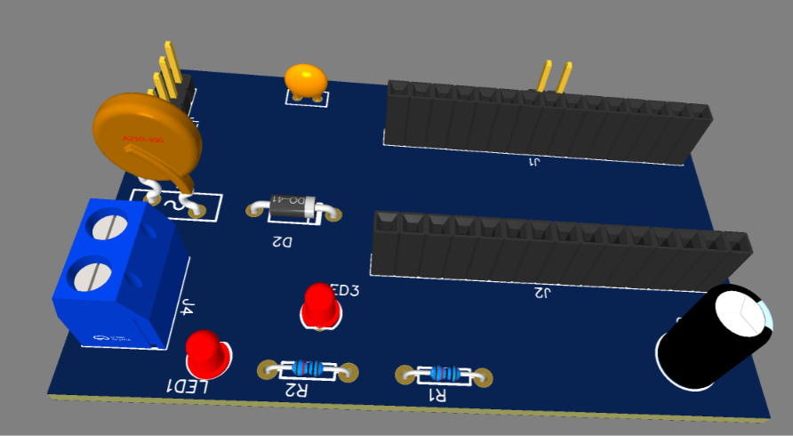

# ESP32 DevKit V1 Expansion Board

A breakout and expansion board for the **30-pin ESP32 DevKit V1**, designed using **EasyEDA Standard**.

The board provides convenient access to ESP32 GPIO pins, an I²C connector, and a protected external power-input section.

> **Project status:** Schematic, PCB layout, BOM, and Gerber files are provided. Physical fabrication, assembly, ESP32 fit, and electrical testing have not yet been confirmed.

## Features

- Two 1×15 female headers for a removable 30-pin ESP32 DevKit V1
- GPIO breakout through the headers
- 4-pin I²C connector
- External power-input connector
- Resettable fuse and Schottky-diode protection in the external power path
- Input capacitors for supply decoupling
- Power indicator LED and GPIO indicator LED

## Repository files

All project files are stored in the repository's root folder:

```text
ESP32-DevKit-V1-Expansion-Board/
├── README.md
├── BOM_ESP32-DevKit-V1-Expansion-Board_2026-11-18.csv
├── Gerber_ESP32-DevKit-V1-Expansion-Board_PCB_ESP32-DevKit-V1-Expansion-Board_2_2026-11-18.zip
└── Schematic_ESP32-DevKit-V1-Expansion-Board_2026-11-18.pdf
```

## Main connectors

### J3 — I²C connector

| J3 pin | Signal | ESP32 connection |
|---|---|---|
| 1 | 3V3 | 3.3 V |
| 2 | GND | Ground |
| 3 | SDA | GPIO21 |
| 4 | SCL | GPIO22 |

### J1 and J2 — ESP32 headers

J1 and J2 are 1×15 female headers intended for the 30-pin ESP32 DevKit V1.

**Important:** ESP32 DevKit V1 boards from different manufacturers may have different pin arrangements. Verify the pin labels on the exact board you intend to install before connecting power or peripherals.

## External power and safety

The external input path is designed around a resettable fuse (F1) and a 1N5819 Schottky diode (D2), with capacitors across the protected supply rail.

- Check the input polarity before applying power.
- The Schottky diode causes a forward-voltage drop, so the voltage after the diode is lower than the input voltage.
- Measure the protected rail and confirm that it is suitable for the board's VIN input before connecting the ESP32.
- **Never apply 5 V to the ESP32 3V3 pin or to any GPIO pin.**
- Do not connect USB and external power at the same time unless the power path and isolation on your exact ESP32 DevKit V1 clone have been verified.
- Disconnect all power before wiring or changing jumper settings.
- 
## Design files

- **Schematic PDF:** [View Schematic](./Schematic_ESP32-DevKit-V1-Expansion-Board_2026-11-18.pdf)
- **Bill of Materials:** [View BOM](./BOM_ESP32-DevKit-V1-Expansion-Board_2026-11-18.csv)
- **Gerber archive:** [Download Gerber ZIP](./Gerber_ESP32-DevKit-V1-Expansion-Board_PCB_ESP32-DevKit-V1-Expansion-Board_2_2026-11-18.zip)
- **3D view:**
The Gerber archive contains PCB manufacturing files. Review the board outline, copper layers, solder masks, silkscreen and drill files before fabrication.

## Before fabrication

- [ ] Verify J1/J2 pin mapping against the exact ESP32 board.
- [ ] Review schematic connectivity and component polarities.
- [ ] Run ERC and DRC in EasyEDA and resolve all unintended warnings/errors.
- [ ] Inspect the Gerber files in an independent Gerber viewer.
- [ ] Confirm connector pitch, component footprints, board dimensions, and mounting clearances.
- [ ] Check the external power voltage under load.
- [ ] Fabricate and assemble the PCB.
- [ ] Test power rails, I²C, GPIO indicator, and ESP32 operation.

## Tools

- EasyEDA Standard

## Project status

This is an electronics design and documentation project. The repository contains design files; it does not claim that the PCB has been manufactured or successfully tested.

## Author

GitHub: [@cheguevarasigma-lab](https://github.com/cheguevarasigma-lab)
